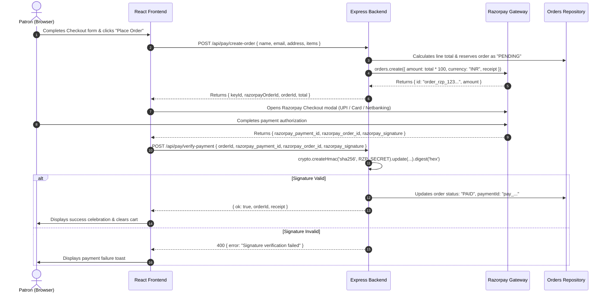

# Feature Specification: Option A — Razorpay Payment Integration & Mandatory Policy Pages

**Objective**: Convert the current unpaid order flow into a production-grade checkout system with automated payment verification via Razorpay, and establish the mandatory legal policy pages required for Razorpay merchant KYC approval and consumer protection.

---

## 1. Overview & Business Requirements

### Current State
- The checkout modal (`frontend/src/features/checkout/CheckoutModal.tsx`) submits an order payload directly to `POST /api/orders`.
- The backend recalculates line items and totals, but creates an order in an unpaid state with no payment gateway transaction ID or status.
- The footer links for "Shipping", "Returns", and "Authenticity" point to placeholder hash links (`href="#"`).

### Target State
1. **Razorpay Standard Checkout Integration**:
   - Patron clicks "Proceed to Checkout" and enters delivery details.
   - Frontend requests order creation on backend (`POST /api/pay/create-order`).
   - Backend creates an official Razorpay order with server-calculated total (in paise: INR × 100) and returns `razorpayOrderId`.
   - Razorpay Checkout modal opens with UPI (GPay, PhonePe, Paytm), Credit/Debit Cards, Netbanking, and International card options.
   - Upon successful payment authorization, payment credentials (`razorpay_payment_id`, `razorpay_order_id`, `razorpay_signature`) are verified on the backend via HMAC-SHA256 signature check (`POST /api/pay/verify-payment`).
   - Order is marked `PAID` in the persistence store with the payment ID attached.
2. **Mandatory Merchant KYC Policy Pages**:
   - Four dedicated policy routes designed in the warm editorial style of the house:
     - `/shipping-policy`: Insured global delivery terms, customs details, transit timelines.
     - `/returns-policy`: 7-day handcrafted return window, GI guarantee, damaged goods protocol.
     - `/terms`: Commercial terms of sale, maker warranties, intellectual property.
     - `/privacy-policy`: Data handling, customer privacy, payment encryption guarantee.
     - `/contact`: Atelier physical address in Srinagar, customer care email, and WhatsApp contact.

---

## 2. Technical Architecture & Data Flow



---

## 3. Data Models & Interface Extensions

### Backend Order Type Update (`backend/src/types/index.ts`)
```typescript
export type OrderStatus = 'PENDING' | 'PAID' | 'FAILED' | 'DISPATCHED' | 'DELIVERED';

export interface Order {
  id: string;
  at: string;
  name: string;
  email: string;
  address: string;
  lines: OrderLineItem[];
  total: number;
  status: OrderStatus;
  paymentMethod?: 'RAZORPAY' | 'COD' | 'WHATSAPP';
  paymentId?: string;
  razorpayOrderId?: string;
}
```

---

## 4. Backend Implementation Steps

### 4.1 Dependency Installation
```bash
cd backend
npm.cmd install razorpay
npm.cmd install --save-dev @types/razorpay
```

### 4.2 Environment Configuration (`backend/.env`)
```env
PORT=4173
ADMIN_KEY=your-secure-admin-key
RAZORPAY_KEY_ID=rzp_test_...
RAZORPAY_KEY_SECRET=your_razorpay_secret...
```

### 4.3 Payment Service & Controller (`backend/src/controllers/payment.controller.ts`)
1. **`POST /api/pay/create-order`**:
   - Validates user payload and calculates line items using catalog prices.
   - Calls `razorpay.orders.create({ amount: total * 100, currency: 'INR', receipt: orderId })`.
   - Records order with status `PENDING` and saves `razorpayOrderId`.
   - Returns `{ ok: true, keyId, razorpayOrderId, orderId, total }`.
2. **`POST /api/pay/verify-payment`**:
   - Receives `orderId`, `razorpay_order_id`, `razorpay_payment_id`, `razorpay_signature`.
   - Computes expected signature:
     ```typescript
     const body = `${razorpay_order_id}|${razorpay_payment_id}`;
     const expectedSignature = crypto
       .createHmac('sha256', process.env.RAZORPAY_KEY_SECRET!)
       .update(body)
       .digest('hex');
     ```
   - Compares signatures using `crypto.timingSafeEqual`.
   - On match: updates status to `PAID`, sets `paymentId`.
   - Returns `{ ok: true, orderId }`.

---

## 5. Frontend Implementation Steps

### 5.1 Razorpay SDK Integration (`frontend/index.html`)
Add the official Razorpay Checkout script with SRI:
```html
<script src="https://checkout.razorpay.com/v1/checkout.js"></script>
```

### 5.2 CheckoutModal Hookup (`frontend/src/features/checkout/CheckoutModal.tsx`)
- On form submission:
  1. Call `api.createPaymentOrder({ name, email, address, items })`.
  2. Instantiate `new window.Razorpay(options)`.
  3. Pre-fill customer name and email.
  4. Specify theme color matching `--gold` (`#B08A47`).
  5. In `handler(response)`: call `api.verifyPayment(response)`.
  6. Upon success: clear cart, close modal, display celebration toast with order number.

### 5.3 Dedicated Policy Pages (`frontend/src/pages/policies/`)
Create elegant, editorial-styled policy pages sharing the global design system (`Navbar`, `Footer`, `Grain`):
1. `ShippingPolicyPage.tsx` (`/shipping`):
   - Complimentary insured delivery worldwide via DHL / FedEx.
   - Archival tissue packaging and handcrafted provenance certificates.
   - Delivery transit time: domestic (3–5 business days), international (7–12 business days).
2. `ReturnsPolicyPage.tsx` (`/returns`):
   - 7-day return policy for unused, tagged pieces.
   - GI Certification authenticity verification protocol.
   - Return shipping instructions and refund processing timeline (T+5 days).
3. `TermsPage.tsx` (`/terms`):
   - Artisan fair-trade declaration.
   - Limitations of liability, price integrity, and currency notes.
4. `ContactPage.tsx` (`/contact`):
   - Physical atelier: *Old City Atelier, Boulevard Road, Dal Lake, Srinagar, J&K 190001*.
   - Direct phone, WhatsApp concierge line, and support email.

### 5.4 Footer Link Wiring (`frontend/src/components/Footer.tsx`)
Replace placeholder `#` links with active React Router `<Link>` components:
```tsx
<div>
  <h4>Care</h4>
  <Link to="/shipping">Shipping Policy</Link>
  <Link to="/returns">Returns &amp; Guarantee</Link>
  <Link to="/terms">Terms of Service</Link>
  <Link to="/contact">Contact &amp; Atelier</Link>
  <Link to="/admin">Atelier Admin</Link>
</div>
```

---

## 6. Acceptance Criteria & Testing Checklist

- [ ] `POST /api/pay/create-order` creates a Razorpay order in test mode with server-calculated total.
- [ ] Razorpay Checkout modal displays the exact INR total and pre-fills customer information.
- [ ] Successful test payment returns verified signature; order status transitions to `PAID` in `orders.json`.
- [ ] Tampered signatures or cancelled transactions do not mark orders as paid.
- [ ] All four policy pages (`/shipping`, `/returns`, `/terms`, `/contact`) render with editorial styling, matching typography, and working navigation.
- [ ] Footer links navigate seamlessly to policy pages without full page reload.
